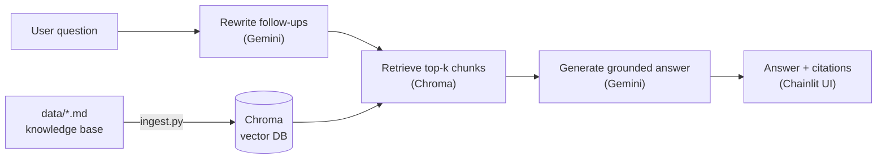

# CURSOR-HELPER-BOT

A Retrieval-Augmented Generation (RAG) chatbot that answers questions about using **Cursor** to build chatbots. It answers only from its own knowledge base, cites the source of every answer, and says **"I don't know."** when the answer isn't there.

This project was built from scratch with Cursor as a hands-on way to learn both RAG and AI-assisted development: planning, rules, prompting, Agent mode, testing, Git workflow, and deployment.

<!-- Add a screenshot: save it as docs/screenshot.png and uncomment the line below -->
<!--  -->

**Live demo:** https://cursor-helper-bot.onrender.com (password protected; the free host sleeps when idle, so the first load can be slow)

## Features

- **Grounded answers:** replies come only from the retrieved knowledge-base chunks, never from the model's general knowledge.
- **Citations:** every answer names the source question, and the matching chunk opens in a side panel.
- **"I don't know" behavior:** out-of-scope questions are refused instead of guessed.
- **Follow-up questions:** "And how do I undo it?" works, because follow-ups are rewritten into standalone questions before retrieval.
- **Streaming replies:** answers appear word by word.
- **Resilient LLM calls:** automatic retries on busy servers and fallback to other Gemini models.
- **Password login** for demos, and a **test suite** that runs without network access.

## How it works



1. **Ingest:** `ingest.py` splits the Markdown knowledge base into one chunk per `Qn.` question and stores the chunks, with metadata, in a local Chroma database.
2. **Retrieve:** `retrieve.py` embeds the question and returns the closest chunks (lowest distance first).
3. **Generate:** `generate.py` sends the chunks and the question to Gemini with strict instructions to answer only from the context and cite chunks like `[Q5]`.
4. **Chat:** `app.py` is the Chainlit interface that ties it together, with login, streaming, history, and source display.

If even the best chunk is farther than `MAX_DISTANCE`, the model isn't called and the bot replies "I don't know."

## Tech stack

| Layer | Choice |
|---|---|
| Language | Python 3.13 |
| Vector store | ChromaDB (local, persistent), default embedding function |
| LLM | Google Gemini via the `google-genai` SDK |
| UI | Chainlit |
| Tests | pytest |
| Hosting | Render (free web service) |

## Project structure

```
CURSOR-HELPER-BOT/
├── app.py                  # Chainlit chat UI (login, streaming, sources, history)
├── generate.py             # Follow-up rewrite, prompt, Gemini calls, citations
├── retrieve.py             # Chroma query returning ranked chunks
├── ingest.py               # Parses the knowledge base and builds the vector DB
├── config.py               # Paths, chunking, top-k, cutoff, model names
├── data/
│   └── cursor_helper_kb.md # The knowledge base (Q&A format)
├── tests/                  # pytest tests for retrieval and generation
├── .cursor/rules/          # Cursor project rules used while building
├── render.yaml             # Render deployment blueprint
├── requirements.txt
├── .env.example            # Names of required environment variables
└── pytest.ini
```

## Getting started

### Prerequisites

- Python 3.10 or newer (developed on 3.13)
- Git
- A free Gemini API key from [Google AI Studio](https://aistudio.google.com)

### Install

```bash
git clone https://github.com/ercharanjotsingh/CURSOR-HELPER-BOT
cd CURSOR-HELPER-BOT

python -m venv .venv
# Windows PowerShell:  .venv\Scripts\Activate.ps1
# macOS / Linux:       source .venv/bin/activate

python -m pip install -r requirements.txt
```

### Configure

Copy `.env.example` to `.env` and fill in the values:

```
GEMINI_API_KEY=your_gemini_api_key
CHAINLIT_AUTH_SECRET=generate_with_chainlit_create_secret
DEMO_USERNAME=choose_a_username
DEMO_PASSWORD=choose_a_strong_password
```

Generate the auth secret with `chainlit create-secret`. **Never commit `.env`**; it is listed in `.gitignore`.

### Build the knowledge base and run

```bash
python ingest.py                 # builds ./chroma_db from data/ (prints the chunk IDs)
chainlit run app.py -w           # opens http://localhost:8000
```

Log in with the `DEMO_USERNAME` and `DEMO_PASSWORD` you set.

You can also test the pipeline without the UI:

```bash
python retrieve.py "Where do project rules live?"   # shows ranked chunks and distances
python generate.py "Where do project rules live?"   # full answer with sources
```

## Configuration

Settings live in `config.py`:

| Setting | Purpose |
|---|---|
| `DATA_DIR`, `CHROMA_PERSIST_DIR`, `COLLECTION_NAME` | Where documents and the vector DB live |
| `CHUNK_SIZE_TOKENS`, `CHUNK_OVERLAP_TOKENS` | Fallback splitting for unusually long chunks |
| `TOP_K` | How many chunks are retrieved per question |
| `MAX_DISTANCE` | If the best chunk is farther than this, the bot answers "I don't know." without calling the LLM |
| `IDK_MESSAGE` | The exact refusal text |
| `GEMINI_MODEL`, `GEMINI_FALLBACK_MODELS` | Primary and backup Gemini models |

Gemini model names are retired and added often. If you see a "model not found" error, pick a current free model in Google AI Studio and update these two settings.

## Updating the knowledge base

RAG changes what the bot knows by changing the **data**, not the model.

1. Edit `data/cursor_helper_kb.md`. Each entry starts with a line like `Q12. Your question?`, followed by the answer. A line like `A. Getting started` starts a section.
2. Re-run `python ingest.py`. It replaces the file's old chunks, so re-running never creates duplicates.
3. Restart the app if it was running.

Tip: add a line such as `Also asked as: ...` to an entry with other ways people phrase the same question. It helps retrieval find the right chunk.

## Testing

```bash
python -m pytest
```

The generation tests use a fake retriever and a fake LLM, so they run offline and don't use your API quota. The retrieval tests need `python ingest.py` to have been run first, and skip themselves otherwise.

## Deployment (Render)

The repo includes a `render.yaml` blueprint.

1. Push the repo to GitHub.
2. In Render, choose **New → Blueprint** and select the repo.
3. Enter the four secrets when prompted: `GEMINI_API_KEY`, `CHAINLIT_AUTH_SECRET`, `DEMO_USERNAME`, `DEMO_PASSWORD`.
4. The start command rebuilds the vector DB and launches Chainlit on Render's port.

Notes for the free plan:

- It has no persistent disk, so the database is rebuilt on every start.
- Free services spin down after about 15 minutes of inactivity, so the first request afterward is slow.
- Memory is limited (512 MB). If the service runs out of memory, move embeddings to the Gemini API or use a larger instance.
- Open the app a few minutes before a demo to wake it up.

## Evaluating quality

Before changing chunk size, `TOP_K`, prompts, or models, write test questions with known answers and compare results. A useful set has:

- **In-scope questions** the knowledge base answers, asked in your own words.
- **Near-miss questions** about the same topic that the documents don't cover (for example, pricing).
- **Unrelated questions** (for example, general knowledge).

Good behavior is a correct, cited answer for the first group and "I don't know." for the other two.

## Limitations

- Retrieval can miss the right chunk when a question is phrased very differently from the text. Adding alternative phrasings or increasing `TOP_K` helps.
- Distance alone can't separate in-scope from out-of-scope questions, so the prompt does most of the refusal work.
- Answers are only as good as the knowledge base, and the bot will repeat whatever the documents say.
- Follow-up questions use two Gemini calls, which uses free-tier quota faster.
- Review Google's current terms for how free-tier API data may be used before putting confidential documents through the bot.

## Ideas for next steps

- Evaluation script that scores a fixed list of test questions automatically
- Reranking retrieved chunks
- Embeddings via the Gemini API to cut server memory use
- Support for PDFs and more document types
- Feedback buttons and basic usage logging

## Built with Cursor

Developed step by step in Cursor using project rules (`.cursor/rules`), small single-purpose prompts, plan-then-approve Agent workflows, one Git branch per feature, and pull requests reviewed before merging.

## License

_Add a license (for example MIT) or remove this section._
